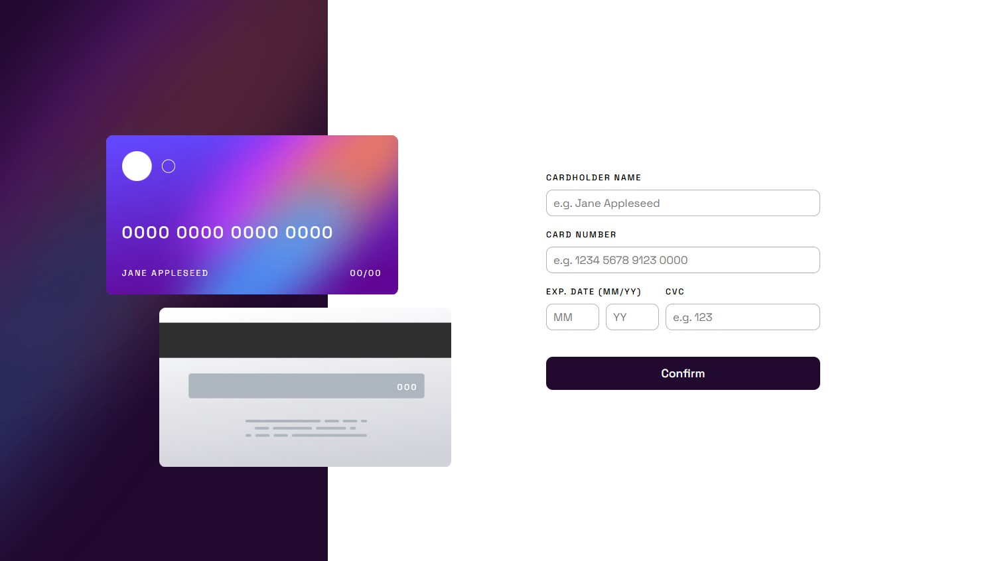
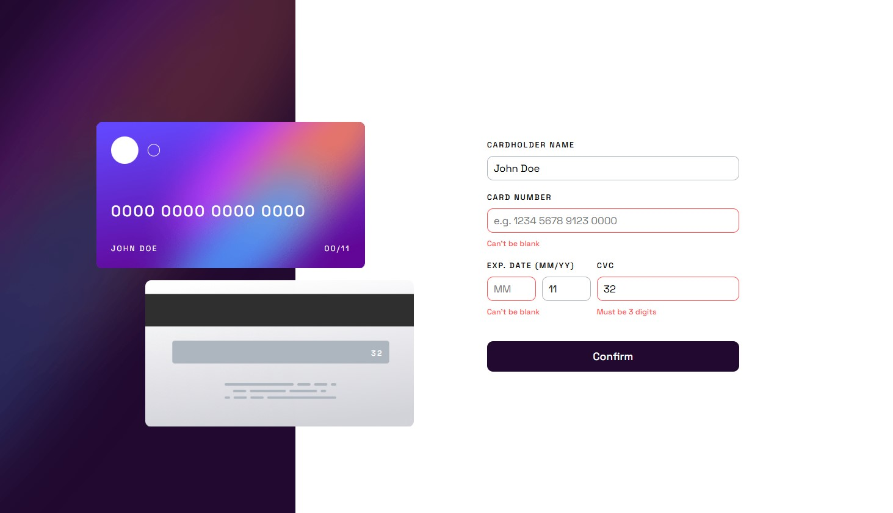
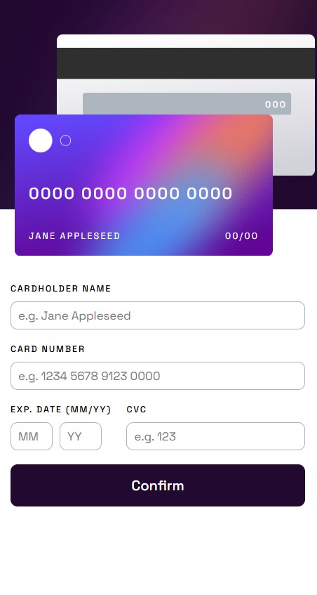
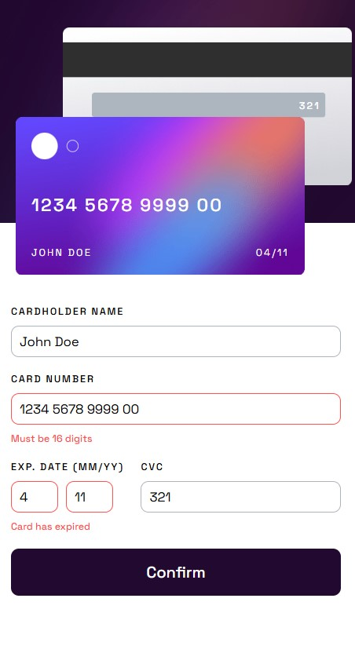

# Interactive Card Details Form - Frontend Mentor


This is a solution to the [Interactive card details form challenge on Frontend Mentor](https://www.frontendmentor.io/challenges/interactive-card-details-form-XpS8cKZDWw). The goal was to build a responsive, accessible form with live card previews, robust validation, and a focus on Object-Oriented Programming (OOP) in Vanilla JavaScript.

## Table of contents

- [📝 Overview](#-overview)
  - [📸 Screenshot](#-screenshot)
  - [🔗 Links](#-links)
- [🛠️ My process](#️-my-process)
  - [🧱 Built with](#-built-with)
  - [📂 Folder Structure](#-folder-structure)
  - [💡 What I learned](#-what-i-learned)
  - [🤝 AI Collaboration](#-ai-collaboration)
- [📄 License](#-license)
- [👤 Author](#-author)

## 📝 Overview

### 📸 Screenshot






### 🔗 Links

- **Live Demo**: [View Live](https://ali-zol.github.io/interactive-card-details-form/)
- **Repository**: [GitHub Repo](https://github.com/Ali-Zol/interactive-card-details-form.git)

## 🛠️ My process

### 🧱 Built with

- Semantic HTML5 markup (`<form>`, `<fieldset>`, `<legend>`, custom `sr-only` class for accessibility)
- CSS Grid (for the overall layout and stacking cards) & Flexbox
- Modern CSS features like `clamp()` for responsive card sizing and `:focus-visible` for accessible focus rings
- Vanilla JavaScript (ES6+) with **Object-Oriented Programming (Classes)** architecture
- Regular Expressions (Regex) for real-time input formatting and validation
- Advanced **Focus Management** for accessibility (auto-advancing inputs and focusing error fields)

### 📂 Folder Structure

```text
/
├── css/
│   └── style.css
├── images/
│   ├── bg-card-back.png
│   ├── bg-card-front.png
│   ├── bg-main-desktop.png
│   ├── bg-main-mobile.png
│   ├── card-logo.svg
│   ├── favicon-32x32.png
│   └── icon-complete.svg
├── screenshots/
│   ├── desktop-active-state.jpg
│   ├── desktop-design.jpg
│   ├── mobile-active-state.jpg
│   └── mobile-design.jpg
├── index.html
├── main.js
├── README.md
└── LICENSE
```

### 💡 What I learned

This project was a major step forward in writing clean, maintainable, and accessible code. Some key takeaways include:

1. **Object-Oriented JavaScript (Classes)**: Instead of writing a long script with scattered functions, I split the logic into two classes: `CardPreview` (handling UI updates) and `FormCardInfo` (handling form logic and validation). I used Dependency Injection to pass the `CardPreview` instance to the `FormCardInfo` class.

    ```js
    class FormCardInfo {
      constructor(cardPreview) {
        this.cardPreview = cardPreview;
        // ...
      }
    }
    ```

2. **Real-time Input Formatting**: I used Regex combined with methods like `replace` and `match` to format the card number (adding spaces every 4 digits) and `padStart` to ensure the expiry month and year always display as two digits.
3. **Accessibility (A11y) First**:

    - Used `aria-describedby` to link error messages to their inputs.
    - Added `role="alert"` so screen readers announce errors immediately.
    - Implemented **Focus Management**: Auto-advancing focus from Month to Year to CVC, and focusing the first invalid input when the form is submitted.
4. **Managing the `hidden` attribute in CSS**: I learned that if an element has `display: grid` or `display: flex` in CSS, the HTML `hidden` attribute won't work because the class selector overrides it. While I initially used `!important` to fix this, I later refactored it to respect the CSS cascade. I solved it by using a more specific selector (like `form[hidden]` or `section[hidden]`).
5. **Advanced CSS Layouts**: Mastering `display: grid` with `grid-template-areas` made the form layout incredibly clean. I also learned how to stack elements (card front and back) in the same grid cell using `grid-area: 1 / 1` instead of `position: absolute`.
6. **DRY Principle (Don't Repeat Yourself)**: I refactored my CSS to extract shared button styles into a `.btn` class, and moved repeated card reset logic into a reusable `resetForm()` method.
7. **Internationalization (i18n) with Logical Properties**: I learned the importance of using CSS logical properties (e.g., `margin-block-end` and `padding-inline-end`) instead of physical ones (e.g., `margin-bottom`, `padding-right`, and `left`). This ensures that the layout automatically adapts to Right-to-Left (RTL) languages like Persian or Arabic without requiring extra CSS, making the UI globally accessible and future-proof.

### 🤝 AI Collaboration

I used an AI mentor (DeepSeek) throughout this project, but with a strict learning-focused approach:

- **How I used it**: Instead of asking for complete code solutions, I used the AI to review my code, explain why certain behaviors occur (like CSS specificity with the `hidden` attribute), and guide me toward finding the right methods (like `padStart` or `clamp()`).

- **Outcome**: This collaborative approach ensured that I actually understood the underlying concepts. Every line of code in this project was written and understood by me.

## 📄 License

This project is open source and available under the [MIT License](LICENSE).

## 👤 Author

- GitHub - [Ali-Zol](https://github.com/Ali-Zol)
- Frontend Mentor - [@Ali-Zol](https://www.frontendmentor.io/profile/Ali-Zol)

## 🙏 Acknowledgments

Thanks to the Frontend Mentor community for providing such a great platform to practice real-world projects. If you have any feedback or suggestions, feel free to open an issue or reach out!
